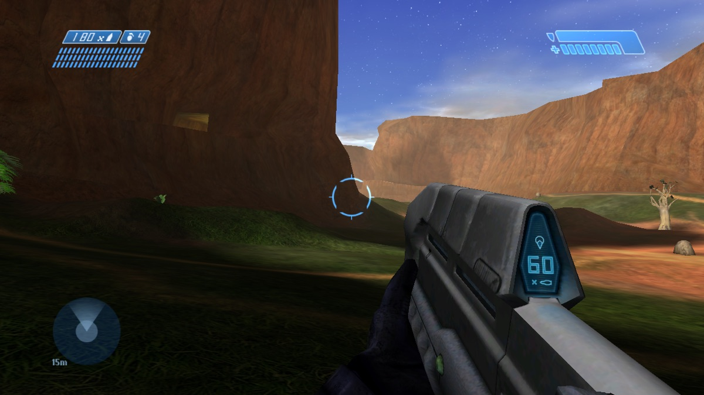

<p align="center"></p>

<h1 align="center">Warthog 360</h1>

<p align="center"><b>Chupathingy on the Xbox 360.</b></p>

<p align="center">
<a href="https://discord.gg/chupathingy">Get the test build (Discord, #xbox-360)</a> ·
<a href="https://stats.chupathingy.org">Games online now</a> ·
<a href="https://github.com/ChupathingyCE/chupathingyce">The game</a> ·
<a href="https://chupathingy.org">chupathingy.org</a>
</p>

<p align="center"></p>

Play Chupathingy as homebrew on an Xbox 360, and join the same online games
as PCs and other consoles.

**Status: early test builds.** Multiplayer is the focus. The campaign isn't
a goal yet. Earlier builds played Blood Gulch on a real console. The newest
test build has so far run in the Xenia emulator, where it reaches the main
menu and plays Blood Gulch.

Test builds are shared in #xbox-360 on the
[Discord](https://discord.gg/chupathingy). You can also build it yourself
(below).

You need your own copy of Halo. No game files or SDK files are included.

This repository holds the Xbox 360 port. The game itself is the
`chupathingyce` submodule. The original Xbox port is
[warthog-xbox](https://github.com/ChupathingyCE/warthog-xbox).

## What you need

- **A console that runs homebrew.** An RGH/JTAG 360, or one running a
  softmod like BadUpdate or BadAvatar, with a launcher such as Aurora. A
  development kit works too.
- **Your own Halo maps.** The `maps` folder from your own original Xbox
  Halo disc: the North American (NTSC) release, 01.10.12.2276, as every
  Chupathingy build and server uses. Warthog never provides maps, disc
  images or other game data, and never links to them. Don't share yours.
- **To build it yourself** (below): a Mac or Linux computer, and your own
  Xbox 360 SDK.

## Install

1. Get the newest test build from #xbox-360 on the
   [Discord](https://discord.gg/chupathingy) and unzip it.
2. Copy its folder to the console's hard drive, for example
   `Hdd1:\Games\Warthog360\` (FTP or XBDM).
3. Put your own Halo maps in its `maps` folder. At least `ui.map` is
   needed.
4. Add the folder to Aurora's content paths, or start `default.xex` from
   your launcher's file browser.

To update, replace `default.xex`. Keep `config.toml`, the `maps` folder
and the `shaders` folder.

## What works

- **Online Games:** lists the games online and joins them, dedicated
  servers too. It joins OpenCE's newest servers (network version 41) and
  older ones. Co-op games are listed too, with a filter.
- **Up to 32 players.** A game that grows past 32 players is left, as a
  full one is.
- **Link your Delta profile:** on Online Games, press **Start**, then **A**
  for a code. Enter it at stats.chupathingy.org/connect, signed in on your
  phone or computer, then press **A** on the console.
- **Split screen:** when you join a game in progress, the host waits a few
  seconds for the other players on your console.
- **Multiplayer maps** load and play offline.

## Known issues

- **Lag**, and the frame rate drops when you shoot at another player
  ([#11](https://github.com/ChupathingyCE/warthog-360/issues/11)).
- **A film-grain-like noise** in the picture over time, and HUD and reticle
  vertices popping.
- **No movies.** The intro and attract videos are skipped.
- **The campaign** isn't tested. 343 Guilty Spark and The Silent
  Cartographer have known drawing problems
  ([#15](https://github.com/ChupathingyCE/warthog-360/issues/15),
  [#16](https://github.com/ChupathingyCE/warthog-360/issues/16)).
- **Not yet checked with the newest build:** scope zoom draws a glitched
  screen ([#9](https://github.com/ChupathingyCE/warthog-360/issues/9)), a
  dark shade follows the player on some maps
  ([#12](https://github.com/ChupathingyCE/warthog-360/issues/12)), the blue
  cursor stretches on open maps
  ([#13](https://github.com/ChupathingyCE/warthog-360/issues/13)), the
  overshield draws wrong
  ([#14](https://github.com/ChupathingyCE/warthog-360/issues/14)), settings
  and the button layout don't save
  ([#8](https://github.com/ChupathingyCE/warthog-360/issues/8)), joining
  games in progress and OpenCE games
  ([#10](https://github.com/ChupathingyCE/warthog-360/issues/10)).

## Reporting problems

1. Copy `port.txt`, `debug.txt` and `logs\debug.txt` from the game's folder
   to your computer.
2. Send them at [dump.chupathingy.org](https://dump.chupathingy.org), with
   "Xbox 360" as the platform. You get a reference code.
3. Tell us in #xbox-360 on the [Discord](https://discord.gg/chupathingy)
   what you were doing, and give the code.

## Files in the game's folder

- `config.toml`: the settings, written at the first start.
- `debug.txt` and `logs\debug.txt`: the game's log. `port.txt`: the
  console layer's log (also on the debug channel).
- `shaders`: compiled shaders, kept so each one is compiled once. Deleting
  the folder is safe: they are compiled again.

[port/xbox360/README.md](port/xbox360/README.md) has the port's details,
how it draws, the networking and the developer tools.

## Building it yourself

Clone with the game:

```sh
git clone --recursive https://github.com/ChupathingyCE/warthog-360.git
cd warthog-360
```

(In a clone you already have: `git submodule update --init`.)

You need:
- Python 3 and [ninja](https://ninja-build.org/).
- [OXDK](https://github.com/MrMilenko/OXDK), whose `xbox360` folder has
  the 360 tools: `~/OXDK/xbox360` (or `--oxdk360 DIR`), with its `cxex`
  built.
- OXDK's patched LLVM (`./oxdk build-llvm` builds it), in `~/llvm-xenon`
  or given with `--llvm-xenon DIR` (`--llvm-xenon ~/oxdk-llvm` for where
  OXDK puts it).
- Your own extracted Xbox 360 SDK, the folder holding
  `lib/xbox/xboxkrnl.lib` (`--xdk360 DIR`, or `XDK_DIR`).

Build:

```sh
python3 chupathingyce/configure.py --console-port port/xbox360 --console-no-debug-asserts \
    --console-players 32 [--xdk360 /path/to/XDK]
ninja xbox360                       # build/xbox360/default.xex
```

`--console-no-debug-asserts` is the build testers get, as on the Wii U
and the original Xbox. It is faster on the console: the debug decomp's
asserts are compiled out, as the retail game had them, except the memory
checks. Leave it out for a build that stops at the first failed assert.
`--console-players 32` is the 32-player build testers get, as on the
original Xbox. Without it the game's configure builds 16.

Without the toolchain or the SDK, `ninja xbox360` says what is missing.
`--console-debug-tools` adds the developer tools (the frame profiler, the
GL layer's timers, the bring-up logs and test switches); a normal build has
none. [docs/building.md](docs/building.md) has every step.

Changes to the game itself go to
[ChupathingyCE/chupathingyce](https://github.com/ChupathingyCE/chupathingyce)
first; this repository then moves its submodule to them. Nothing from
Microsoft's SDKs is in this repository, and none of it may be committed.

## License

Warthog 360 is free software: you can redistribute it and modify it under
the terms of the GNU General Public License as published by the Free
Software Foundation, either version 3 of the License or (at your option) any
later version (`GPL-3.0-or-later`), with the console SDK permission below.
It comes with no warranty. The full text is in [LICENSE](LICENSE).

- **From the GPL change onward.** Warthog follows Chupathingy, which is GPL
  from release 0.8.0. The source at every commit before the change was
  released under [CC0 1.0](LICENSES/CC0-1.0.txt) and stays that way.
- **What Warthog builds on.** The Halo CE decompilation
  ([punpckhdq/halo](https://github.com/punpckhdq/halo) and
  [bnunu/halo-1](https://github.com/bnunu/halo-1)) and OpenCE are released
  under CC0 1.0, which lets anyone build on them under any terms. Their
  repositories stay CC0.
- **The game** (the `chupathingyce` submodule) is under its own
  repository's license, with its third-party code, fonts and art under
  theirs.
- **Halo itself is not covered.** The license covers the work of Warthog's
  and Chupathingy's authors. It gives no rights in Halo, its maps or
  anything else Microsoft owns, and no SDK is included.

### Console SDK permission

You may build Warthog yourself with a console maker's SDK (see "Building it
yourself"), and share what you build:

> **Additional permission under GNU GPL version 3 section 7**
>
> If you modify this Program, or any covered work, by linking or combining
> it with the libraries of a Microsoft Xbox or Xbox 360 software development
> kit (such as the Xbox Development Kit and the Xbox 360 SDK, including
> their `xnet.lib` and Direct3D libraries), or a modified version of those
> libraries, containing parts covered by the terms of those kits' licenses,
> the licensors of this Program grant you additional permission to convey
> the resulting work. Corresponding Source for a non-source form of such a
> combination shall include the source code of the covered work, and need
> not include the source code of those libraries.

The permission only lifts the GPL's own objection. It grants no rights in
Microsoft's libraries, whose own terms still apply, and you may remove it
from your copies (section 7). Warthog's own published builds are made only
with free, legally available tools and libraries; none contains code from
Microsoft's SDKs.

## Support

Chupathingy is free and always will be. Support through
[Ko-fi](https://ko-fi.com/milenko) goes to running the site and the servers. If
there's a specific developer or port you'd like to support, ask them: they may
not be part of our community.

## Credits

- The decompilation: [punpckhdq/halo](https://github.com/punpckhdq/halo) and
  [bnunu/halo-1](https://github.com/bnunu/halo-1), of the Xbox build 2342.
- The game: [Chupathingy](https://github.com/ChupathingyCE/chupathingyce),
  and OpenCE and its contributors, up to October 9, 2026.
- Warthog 360: [Milenko](https://github.com/MrMilenko) and contributors.
  The toolchain: [OXDK](https://github.com/MrMilenko/OXDK).
- Libraries: zlib, KCP, Monocypher, Expat, tomlc17 and the other libraries
  the game uses, with their licenses in the game's `port/third_party`.

The port's history up to this repository is in
[ChupathingyCE/warthog-xbox#28](https://github.com/ChupathingyCE/warthog-xbox/pull/28)
(branch `xbox360-next`).

## Links

- The game: [ChupathingyCE/chupathingyce](https://github.com/ChupathingyCE/chupathingyce)
- The original Xbox: [ChupathingyCE/warthog-xbox](https://github.com/ChupathingyCE/warthog-xbox)
- Games online now: [stats.chupathingy.org](https://stats.chupathingy.org)
- Discord: [discord.gg/chupathingy](https://discord.gg/chupathingy)
  (#warthog-support for help, #warthog-dev for development)

Warthog is an unofficial fan project. It isn't affiliated with or endorsed
by Microsoft, Xbox Game Studios, Bungie or Halo Studios. Halo is a trademark
of Microsoft. No game files are included: you bring your own copy. The code is released under the GNU GPL, version 3 or later
(see [License](#license)).
